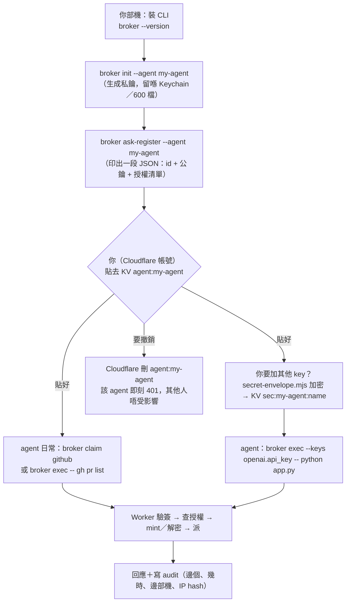
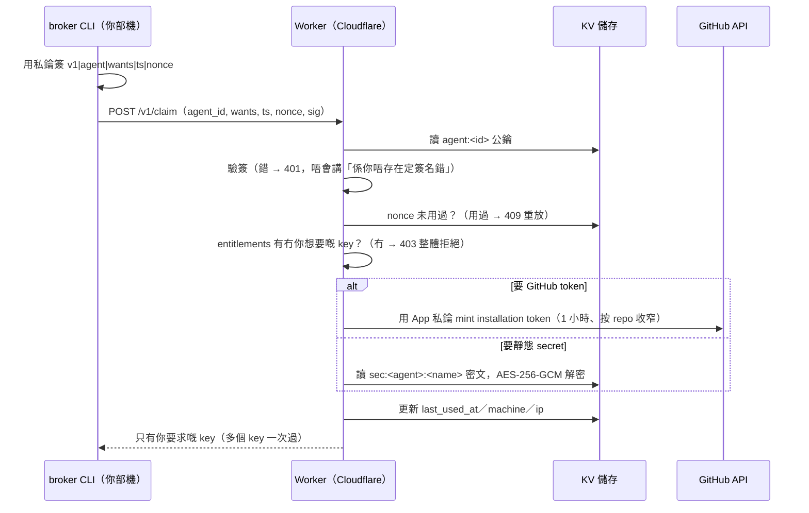

# Secret Broker for Agent

> 原 repo 用途：`agent-playground` — 私人 repo，用來測試 agent 嘅 GH CLI / access / CLI。
> 現時同時承載 **Secret Broker** 嘅 CLI 同 Worker 原始碼。

每個 agent 一個身份，自己嚟攞自己嗰份 secret。無共享密碼、無「一個 token 通全場」。

```
opencode ─┐                         ┌─ GitHub App → installation token（按 repo 收窄）
doubao   ─┼─ Ed25519 簽名 claim ──> │
grok     ─┘   (Worker 驗簽)         └─ 靜態 secret（SMTP app password / API key / PEM…）
```

## 為何要簽名而唔用 bearer token

| 問題（舊做法：一個 `AGENT_TOKEN`） | 簽名制 |
| :-- | :-- |
| 一張 token 洩漏 = 全部 agent 失守 | 每個 agent 一對密鑰，洩漏只影響自己 |
| 撤銷要換 token，全部 agent 一齊斷 | 刪 registry 一條記錄，該 agent 即時失效，其他人不受影響 |
| 無身份，log 只知「有人 call」 | `agent_id` 入簽名，audit log 可追誰拿了什麼 |
| 重放攻擊無防備 | `ts` ±60s + `nonce` KV（120s TTL），同一請求只能一次 |
| 權限全開 | `entitlements` 逐項授權；GitHub token 再按 repo / permission 收窄 |

私鑰永遠留在 agent 本機（macOS Keychain / 600 權限檔），**永不經網絡傳出**；broker 只存公鑰。


## 用家視角：呢套嘢到底係咩（先睇呢節）

**一句話**：`broker` 係一個「只認簽名嘅鎖匙箱」。你部機有一條私鑰（好似身份證，永遠唔會交出街），
Cloudflare 只存你嘅公鑰（用嚟核對「真係你」）。你嚟攞 key，佢核對簽名就派，**唔會問你密碼、亦冇一張「萬能 token」**。

### 三個角色，邊個可以做咩

| 角色 | 係邊個 | 可以做 | 唔可以做 |
| :-- | :-- | :-- | :-- |
| **你**（Cloudflare 帳號持有人） | 只有你 | 加 agent、加／換 key、改授權、刪 agent | ——（你係唯一 root of trust） |
| **每個 agent／每部機** | 你部電腦、CI runner、雲機 | 用自己私鑰 claim 自己被授權嘅 key | 改任何 registry／secret、刪任何嘢 |
| **Worker** | Cloudflare 上面嘅程式 | 驗簽、派 key、寫 audit | 改資料（**冇 admin API，設計上做唔到**） |

> 即係話：**就算有人拿到你嘅 CLI 原始碼、甚至拿到你嘅 agent 私鑰，佢最多只拿到「你自己已經授權嘅那幾個 key」**，
> 唔會拿到其他人嘅、亦改唔到任何設定。唯一可以「全盤通吃」嘅係 Cloudflare 帳號本身。

### 流程圖：由零到拿到 key



### 一次 claim 入面發生咩事（時間序）



### 「我幾時要做咩」對照表

| 你想做嘅事 | 你要做（人） | 用邊條指令／邊度 |
| :-- | :-- | :-- |
| **第一次裝** | 裝 CLI（release tarball + sha256 驗證） | `bash scripts-bootstrap-install.sh` |
| **換新電腦** | ① `endpoint set` 一次 ② `init`／搬私鑰 ③ 其餘照舊 | `broker endpoint set <url>` → `broker init` |
| **新機／新 agent 加入** | ① 部機 `init` ② 印 JSON ③ 你去 Cloudflare 貼 | `broker init` → `broker ask-register` → KV put |
| **日常拿 GitHub token** | 乜都唔使做，直接跑 | `broker exec -- gh pr list`（或 `broker claim github`） |
| **加一個新 key（OPENAI／Azure…）** | ① 攞 agent 密封公鑰 ② 本機 seal ③ Cloudflare 寫 `sec:` ④ 改 `entitlements` | `broker enc-pubkey` → `secret-seal.mjs` → `wrangler kv key put` |
| **換 value（輪替同一條 key）** | 重新加密覆寫同一個 `sec:` key | agent 唔需要改任何嘢，下次 claim 就係新值 |
| **懷疑私鑰洩漏** | `rotate` 生成新 key → 去 Cloudflare 換公鑰 | `broker rotate` → `ask-register` |
| **某部機／某 agent 唔再用** | 去 Cloudflare 刪 `agent:<id>` | KV delete（CLI 冇呢個功能） |
| **查邊個用過、邊個試圖入侵** | 查 D1 audit 表 | `wrangler d1 execute …`（見「審計」節） |
| **本機完全連唔到 workers.dev** | 唔關 broker 事（係 SNI 封鎖）；改用 CI runner 驗 | 見「網絡限制」節 |

### `claim` 同 `exec` 到底咩關係（最多人誤解嘅位）

| 問題 | 答案 |
| :-- | :-- |
| claim 完一次，之後同機 `exec` 係唔係直接識用個 token？ | **唔係。冇任何 cache。** `exec` 每次都係「即刻做一次全新 claim」：新 nonce、新時間戳、**新 mint 嘅 GitHub token** |
| 咁 token 會唔會留喺部機？ | 唔會落磁碟。只存在**子進程嘅環境變數**，子進程一完就消失 |
| 咁我跑 100 次 `exec` 會唔會 mint 100 次 token？ | 會。所以**一個 script 應該用一次 `exec` 包住**：`broker exec -- bash run-all.sh`，唔好逐條命令 `exec` |
| 可唔可以自己 export 之後用？ | 可以（`broker claim github --env` 印 `export GH_TOKEN=…`），但 token 會留喺 shell／history／環境，安全性差過 `exec`。只建議一次性 debug |
| 可以一次拿幾個 key？ | 可以：`broker claim a b c` 或 `broker exec --keys a,b,c -- cmd`；上限 12 個 |
| 拿唔到其中一個會點？ | 若任何一個唔在 `entitlements` → **整體 403，一個都唔派**（唔會派一半） |

### 非 GitHub 嘅 key（OPENAI、Azure、自訂 endpoint）得唔得？

**得，而且係同一個機制。** 任何字串都可以做 secret：API key、endpoint URL、model 名、甚至一段 JSON。

規則只有一條：**secret 嘅「名」會變成環境變數名**（大寫、非英數變 `_`）。

| 你喺 broker 用嘅名 | `exec` 後嘅環境變數 |
| :-- | :-- |
| `github` | `GH_TOKEN` 同 `GITHUB_TOKEN`（特例，一次給兩個） |
| `openai.api_key` | `OPENAI_API_KEY` |
| `azure.openai.api_key` | `AZURE_OPENAI_API_KEY` |
| `azure.openai.endpoint` | `AZURE_OPENAI_ENDPOINT` |
| `azure.openai.deployment` | `AZURE_OPENAI_DEPLOYMENT` |

**完整例子（用 OpenAI，唔想 key 落 `.env`／`~/.zshrc`）**

```bash
# ── 你（管理員）一次性 ────────────────────────────────
# 1) 攞 agent 嘅「密封公鑰」（公開資料，喺 agent 部機印）
broker enc-pubkey --agent my-agent
# 2) 用該公鑰密封（明文只喺你部機出現，輸出係密文；Worker 冇能力解）
printf '%s' 'sk-proj-xxxx' | node scripts/secret-seal.mjs --agent my-agent --name openai.api_key --enc-pubkey <上面嗰條公鑰>
# 2) 跟住照佢印出嘅指令寫入 Cloudflare KV：sec:my-agent:openai.api_key
# 3) 喺 agent:my-agent 嘅 JSON entitlements 加 "openai.api_key"
#    （同一個 JSON 可加 azure.openai.endpoint 等）

# ── agent 日常 ────────────────────────────────────────
broker exec --keys openai.api_key,azure.openai.endpoint -- python app.py
```

```python
# app.py —— 完全唔需要知道 key 喺邊
import os
key = os.environ["OPENAI_API_KEY"]
base = os.environ.get("AZURE_OPENAI_ENDPOINT")  # 有就自動有
```

> **要唔要連 endpoint 都放入 broker？** endpoint／model 名唔算秘密，寫死喺 code 最簡單。
> 放 broker 嘅好處係「一部機一份設定」，壞處係每次 claim 多一個 key、多一次解密。**建議：真秘密入 broker，非秘密寫喺 code。**

## 目錄

| 路徑 | 內容 |
| :-- | :-- |
| `src/index.ts` → `dist/index.js` | `broker` CLI（TypeScript，全域指令）；`dist` 已 commit，安裝時唔需要 build |
| `worker/` | Cloudflare Worker（驗簽 + 派 secret） |
| `worker/scripts/s5-proof.sh` | 舊 bearer flow 的 token 過期驗證腳本（S5 用） |
| `scripts-bootstrap-install.sh` | agent 機安裝腳本（clone → `npm pack` → 全域裝） |
| `agents/START.md` | 給要用 broker 的 agent（安裝後點用、DO & DONT） |
| `agents/TECH.md` | 給接手開發的 agent（架構、API 契約、部署／發版 playbook） |
| `agents/AUDIT.md` | 給 audit agent（宣稱清單、風險登記冊、audit playbook） |

## 安裝

**推薦：由 release tarball 裝（pin 版本 + sha256 驗證）**

```bash
# A. 一鍵（推薦；private repo 需要只讀 token：fine-grained PAT 只勾 Contents:Read，或 GitHub App installation token）
read -rsp 'GitHub read token: ' GH_TOKEN && echo
GH_TOKEN="$GH_TOKEN" bash scripts-bootstrap-install.sh            # 預設 pin v0.5.0

# 想 pin 其他已發佈版本：
GH_TOKEN="$GH_TOKEN" REL_TAG=v0.5.0 bash scripts-bootstrap-install.sh

# B. 已經手動 clone 落機（完全離線，唔需要 token）
bash ~/src/agent-playground/scripts-bootstrap-install.sh --dir ~/src/agent-playground

# C. 應急：直接由 repo ref 裝（唔 pin、無 checksum，只限網絡故障時）
GH_TOKEN="$GH_TOKEN" REF=main bash scripts-bootstrap-install.sh --from-git
```

安裝流程（A 模式）：

1. `GET /repos/…/releases/tags/<REL_TAG>` 取 asset id（private repo 用 API asset URL；`github.com/…/releases/download/…` 會 404）
2. 下載 `nine-ai-secret-broker-cli-<ver>.tgz` 同同名 `.sha256`
3. `sha256sum -c` 驗證，唔符即中止（**唔會**裝落去）
4. `npm i -g` tarball，最後核對 `broker --version` 同 release tag 一致

驗證：

```bash
broker --version     # 例：broker 0.4.0
broker help
broker whoami
```

> 唔建議 `npm i -g github:nine-ai-2046-1/agent-playground`：會跟隨 `main` HEAD（供應鏈風險），
> 而且喺已有安裝上重裝會撞 npm `ENOTEMPTY`。要用就用 `--from-git` 加 `REF=<tag 或 commit sha>`。

## 快速開始（4 步）

> **默認冇 endpoint**（唔會偷偷連任何網址）。每部機只需設定一次，之後任何 folder 都用同一個。

```bash
# 0. 部機設定 broker endpoint（部機層級，存 ~/.config/secret-broker/endpoint，600）
broker endpoint set https://<你嘅-worker>.workers.dev

# 1. 部機生成身份（私鑰留本機：macOS Keychain／Linux 600 檔）
broker init --agent my-agent

# 2. 印出要登記嘅 JSON（貼去 Cloudflare KV；CLI 唔會自己寫）
broker ask-register --agent my-agent --entitlements github --installation-id 185701417

# 3. 日常用（每次自動全新 claim，唔會 cache）
broker exec -- gh pr list
```

> 完整「邊個角色做咩、幾時做」見上面〈用家視角〉同〈流程圖〉。

## 指令

| 指令 | 作用 |
| :-- | :-- |
| `broker endpoint show \| set <url> \| clear` | 設定／查看／清除**部機層級** endpoint（默認冇） |
| `broker init --agent <id> [--broker-url <url>]` | 生成 keypair、寫 config、印簽名公鑰＋密封公鑰 |
| `broker enc-pubkey` | 由私鑰推導 X25519 密封公鑰（貼上 registry／畀人 seal secret） |
| `broker whoami` | 顯示本機 agent / broker / 有冇私鑰 |
| `broker health` | 檢查 broker 可達性（`/health`） |
| `broker pubkey` | 由私鑰推導公鑰（貼上 Cloudflare 用，唔需要抄） |
| `broker ask-register` | 印出要人手寫入 Cloudflare KV 嘅 agent JSON |
| `broker claim [key…] [--print\|--env\|--json]` | 簽名 claim；預設遮罩 |
| `broker exec [--keys a,b] -- <cmd…>` | claim 後注入環境變數執行（推薦） |
| `broker rotate` | 換 keypair（舊公鑰即刻失效；新公鑰要喺 Cloudflare 更新） |
| `broker version \| --version \| -v` | 印版本 |
| `broker help \| --help \| -h` | 印說明（含文件索引、退出碼） |

設定層級（由高至低）：`BROKER_URL` 環境變數 → 部機 endpoint 檔 `~/.config/secret-broker/endpoint` → 舊 `config.json` 內 `brokerUrl`（一次性自動遷移去 endpoint 檔）。
`~/.config/secret-broker/config.json` 而家只存 `agentId`（600）。
其他環境變數：`BROKER_AGENT_ID`（預設 agent）、`BROKER_PRIVATE_KEY`（CI／容器用私鑰）。

CLI 退出碼：`0` 成功、`1` 執行錯誤、`2` 用法錯誤（包括冇打指令、缺參數、agent id 格式錯）；claim 專用 `3` 401、`4` 403、`5` 404、`6` 409。

secret key → 環境變數：`github` → `GH_TOKEN` 及 `GITHUB_TOKEN`；其他 key 大寫、非英數轉底線（`smtp.password` → `SMTP_PASSWORD`）。

## API

### `POST /v1/claim`

```json
{
  "agent_id": "opencode-01",
  "wants": ["github"],
  "ts": 1732700000,
  "nonce": "b64url-random-16B",
  "sig": "base64url(Ed25519('v1|agent_id|wants.join(,)|ts|nonce'))"
}
```

回應（200，或部分成功 207）：

```json
{
  "agent_id": "opencode-01",
  "secrets": { "github": { "token": "ghs_…", "expires_at": "…", "permissions": {…} } },
  "errors": [],
  "claimed_at": "…",
  "expires_at": "…"
}
```

| 情況 | 回應 |
| :-- | :-- |
| 簽名錯 / agent 不存在 / 已撤銷（身份類） | `401` plain `Unauthorized`（唔分原因，防枚舉） |
| `ts` 超出 ±60s | `401 stale_or_skewed_timestamp`（時間類錯誤會講原因，方便校時） |
| nonce 重用 | `409 replay_detected` |
| 未在 `entitlements` | `403 not_entitled`（列出 `denied`） |
| 超過限流（默認 40 次／分鐘／agent+IP） | `429 rate_limited` + `Retry-After`、`retry_after` |

### 註冊與管理（**Cloudflare 帳號層，唔經 Worker**）

Worker **冇任何 admin API**：`/v1/agents`、`/v1/secrets`、`/v1/admin/*` 全部 404。registry 同 secret 只可以由 Cloudflare 帳號持有人寫入 —— 所以 CLI 原始碼可以公開派，因為佢冇能力改任何伺服器資料。

**① 新 agent 註冊**

```bash
broker init --agent opencode-01                          # 本機生成 keypair
broker ask-register --agent opencode-01                                   # 印出完整 agent JSON + wrangler 指令
```

跟住喺 Cloudflare 做（Dashboard → Workers KV → `BROKER_KV` → 新增 key，或者）：

```bash
cd worker
npx wrangler kv key put --binding=BROKER_KV --remote "agent:opencode-01" '<上面印出嘅 JSON>'
```

**② 加靜態 secret（值只喺你部機加密）**

```bash
printf 'my-smtp-password' | node scripts/secret-envelope.mjs --agent opencode-01 --name smtp.password
# 會印出密文信封 + 一行 wrangler kv key put
```

**③ 改 entitlement / 公鑰 / 停用**

直接改 `agent:<id>` 嘅 JSON（`entitlements`、`pubkey`、`status:"disabled"`）。

**④ 撤銷（刪除）**

`wrangler kv key delete --binding=BROKER_KV --remote "agent:<id>"` 或 Dashboard 刪 key。**CLI 冇 delete 指令，Worker 亦冇 DELETE 端點** —— 刻意令「消滅一個身分」只能由雲帳號做。

| 資料 | KV key | 邊個寫 |
| :-- | :-- | :-- |
| agent 記錄 | `agent:<id>` | Cloudflare 帳號 |
| 靜態 secret（密文信封） | `sec:<agent>:<name>` | 本機加密 → Cloudflare 帳號 |
| nonce / 限流計數 | `nonce:*` / `rl:*` | Worker（自動，TTL 過期） |

### 舊 endpoint 已完全下架

`POST /github-token` 同所有 admin 路徑一樣回 **404**，程式碼已移除（唔再靠 flag 開關）。

## KV 結構（`BROKER_KV`）

| Key | 內容 |
| :-- | :-- |
| `agent:<id>` | `{id, pubkey, status, entitlements, github{…}, created_at, updated_at}` |
| `sec:<agent>:<name>` | **v2 密封信封**：`{v:2, alg:"X25519-A256GCM", epk, iv, ct}`（AAD 綁 `sec\|<agent>\|<name>`；KV 內**無明文**，Worker **冇私鑰所以解唔到**）|
| `nonce:<agent>:<nonce>` | `"1"`，TTL 120s（重放保護）|

## 限流（N2）

固定窗（KV 計數，60s 視窗），超限即 `429` + `Retry-After: <秒>`：

| 桶 | 默認 | 覆寫 secret | key |
| :-- | :-- | :-- | :-- |
| claim | 40/min | `CLAIM_RATE_LIMIT` | agent + IP |

```bash
wrangler secret put CLAIM_RATE_LIMIT   # 例：20
```

> 限流係 best-effort：KV 最終一致，多 colo 之間可能有少量超額，用嚟擋失控 loop，唔係 DDoS 防護（邊緣層仍建議 Access／WAF）。

## 突發請求會點（KV 寫入上限）

Cloudflare KV 對同一個 key 有「每秒 1 次寫入」上限，密集 claim 會撞到：

| 情況 | 你見到 | 系統做咗乜 |
| :-- | :-- | :-- |
| 限流計數寫唔到 | 正常派 key | 降級放行，log 記 `rate_limit_degraded`（唔會 500） |
| 重放 nonce 寫唔到 | `503 kv_unavailable` + `Retry-After: 5` | 寧願唔派（fail-closed），避免重放 |
| 短時間超過 40 次／分鐘 | `429 rate_limited` + `Retry-After` | 正常限流 |

> 所以「一個 script 用一次 `exec` 包住」既係效率，亦係避免撞限流。

## 為何冇 admin API（2026-11-27 定案）

| 原因 | 說明 |
| :-- | :-- |
| 收窄攻擊面 | 少一套可被暴力猜測／重放嘅共享 token；Worker 只剩 `/health` + `/v1/claim` |
| 單一 root of trust | 改資料 = Cloudflare 帳號（開 2FA 之後只有你做到），CLI／source 派街坊都冇所謂 |
| 無「靜默接管」 | 冇 PUT 端點就冇得覆蓋別人公鑰；要換 key 就要喺 Cloudflare 手動改，一定有紀錄 |
| 無 delete 面 | 撤銷只可以喺雲帳號做，冇任何 client 可以單方面刪身分 |

## 審計（N4）

每次 claim（成功／失敗、包括重放同限流）都會寫。**離線指令（`init`／`whoami`／`ask-register`／`rotate`）完全唔上網，所以冇 log** —— 呢個設計刻意：只關注「邊個用過 broker、邊個試圖入侵」。

| 去邊 | 內容 |
| :-- | :-- |
| Cloudflare log（console JSON） | 全量，供 `wrangler tail` / Logpush |
| D1 `broker-audit.audit` | `id, ts, kind, agent_id, actor, action, wants, result, status, ip_hash, ua, latency_ms, details, machine_id` |

設計約束：

- **永不記 secret 值**（只記 name / 長度 / 結果）
- `machine_id` = 呼叫端 `X-Broker-Machine`（IOPlatformUUID→SHA-256 前 16 hex，唔含原始硬體 ID）；缺／格式錯記 `-`
- 成功 claim 會同時更新 KV `agent:<id>` 嘅 `last_used_at`／`last_used_machine`／`last_used_ip`，用嚟 housekeeping
- IP 只存 `SHA-256(CF-Connecting-IP)` 前 16 hex，唔存原文
- 寫入用 `ctx.waitUntil`，D1 掛咗都唔會拖死 claim（只記 `audit:write_failed` 落 console）
- **成功派發會更新 `agent:<id>.last_used_at` / `last_used_machine`**（housekeeping 用：超過 N 日冇用就考慮刪）
- **Housekeeping 查詢**（搵邊個 agent 冇人用）：

  ```bash
  npx wrangler d1 execute broker-audit --remote --command \
    "SELECT agent_id, MAX(ts) AS last_claim, COUNT(*) AS claims FROM audit WHERE result='ok' GROUP BY agent_id ORDER BY last_claim"
  ```

  超過 30 日冇 claim 就考慮喺 KV 刪 `agent:<id>`（同 KV 內嘅 `last_used_at` 對照）。

- 查（Cloudflare 帳號層，冇 HTTP 讀取端點）：
  `wrangler d1 execute broker-audit --remote --command "SELECT ts,agent_id,result,status,ip_hash,machine_id FROM audit ORDER BY id DESC LIMIT 20"`

## 靜態 secret：端到端密封（v2，Worker 盲）

> 舊版（N3）用 Worker 內 `BROKER_MASTER_KEY` 做信封加密：安全前提係「信任 Cloudflare 同 Worker 代碼」。
> 新版改成 **只有 agent 本機解得**：密封只用公開嘅 X25519 公鑰，私鑰永遠唔離開 agent 部機 → Worker 即使被完全接管、KV 被 dump，都只得密文。

| 項 | v2 設計 |
| :-- | :-- |
| 金鑰交換 | X25519（一次性臨時 keypair `epk` + agent 長期密封公鑰） |
| 對稱加密 | HKDF-SHA256（salt=`broker\|<agent>\|<name>`，info=`secret-broker-v2`）→ AES-256-GCM，12-byte IV |
| AAD | `sec\|<agent>\|<name>` — key 搬去第二個 agent／改 secret 名即解唔到（防調包） |
| KV 內 | `{"v":2,"alg":"X25519-A256GCM","epk":"…","iv":"…","ct":"…"}`（`ct` 已含 16-byte GCM tag） |
| Worker 角色 | 只做「原封不動轉發」：認到 `v:2` 就回 `{sealed: <原字串>}`，**零解密能力** |
| agent 側 | `broker claim`／`exec` 收到 `sealed` 後用本機私鑰（同一條 Ed25519 種子確定性衍生 X25519）解封 |
| 舊格式 | `v:1` master-key 信封／明文仍然讀得到（Worker 解得返），方便遷移；但新寫入一律 v2 |

```bash
# 寫入方（只需要公鑰；明文唔會離開呢部機）
broker enc-pubkey --agent <id>                      # 喺 agent 部機印（公開資料）
printf '%s' "$OPENAI_API_KEY" | node scripts/secret-seal.mjs \
  --agent <id> --name openai.api_key --enc-pubkey <b64url>
# 跟住照印出嘅 wrangler kv key put 指令寫入 Cloudflare KV

# agent 部機（本機解密，Worker 全程見唔到明文）
broker claim openai.api_key --print
```

**X25519 公鑰點嚟？** 由同一條 Ed25519 私鑰確定性衍生（`SHA-512(seed)` 前半 + clamp），所以舊 agent **唔需要重新 init**、唔需要新 storage；`broker init`／`ask-register` 會自動印／寫入 `enc_pubkey` 欄位。

`BROKER_MASTER_KEY` 由 N3 遺留落嚟，只用嚟讀舊 `v:1` secret；如果 KV 內全部轉晒 v2，呢個 secret 可以刪。

## CI 驗證（生產 E2E）

`.github/workflows/e2e-prod.yml` 由 GitHub runner（乾淨出口）打生產 worker，補本機／內網出口被封嘅缺口。觸發：`workflow_dispatch`、`push main`、每日 `01:00 UTC`。

Repo secrets（Settings → Secrets and variables → Actions）：

| Secret | 值 |
| :-- | :-- |
| `BROKER_PRIVATE_KEY` | CI agent 私鑰（base64 PKCS#8，單行） |
| `BROKER_AGENT_ID` | `ci-e2e-01`（生產 KV 已登記） |
| `BROKER_URL` | `https://github-token-broker.baobao2046.workers.dev` |

冇 secret 都跑得（只做 health／舊 endpoint 404／錯簽 401／契約測試）。報告寫入 `e2e-report.json` 並 commit 回 main（`[skip ci]`），**只含 token 嘅 `prefix`／`len`／`expires_at`／`permissions`，永不含 token 值**。

## 已知限制

1. **Cloudflare Access 未開**：Zero Trust Free 要綁信用卡（$0 但要授權超額收費），所以邊緣層未有 Access Service Token；現時保護全靠 Worker 內簽名驗證。
2. registry 只可以由 Cloudflare 帳號寫入（已冇 admin API）。**Cloudflare 帳號 = 唯一 root of trust**：請務必開 2FA、用最小權限 API token。
3. **私鑰單點（v2）**：agent 私鑰遺失＝永久解唔到已密封嘅 secret（依定案「失鑰不救」，要用 `broker rotate` 換 keypair 再重新 seal 全部 secret）。舊 `v:1` 信封另需 `BROKER_MASTER_KEY`（只為向後兼容而保留）。
4. `wants` 最多 12 項，`repositories` 最多 20 個。
5. 舊 bearer endpoint 仍然存在，文件齊備後應下架。

## Roadmap

- claim token 短期快取，減少 GitHub API 呼叫
- Access / Service Token 作為第二層（要卡）
- `broker run --env-file` 一次過注入多個 secret

## 角色文件（給 agent 讀）

| 文件 | 對象 | 內容 |
| :-- | :-- | :-- |
| `agents/START.md` | 要用 broker 的 agent | 前提檢查、常用指令、env 對應、退出碼、DO & DONT |
| `agents/TECH.md` | 接手的 developer agent | 架構、API 契約、KV 模型、部署／發版／測試 playbook、已知陷阱 |
| `agents/AUDIT.md` | audit agent | 宣稱清單、控制清單、風險登記冊（P0–P2）、audit playbook、測試案例、證據要求 |

審核基線（2026-11-27 N7 後）：Worker 只暴露 `/health` + `/v1/claim`，admin API 全撤；契約測試 22/22；D1 `broker-audit` 有 `machine_id` 欄；Access 未開。
